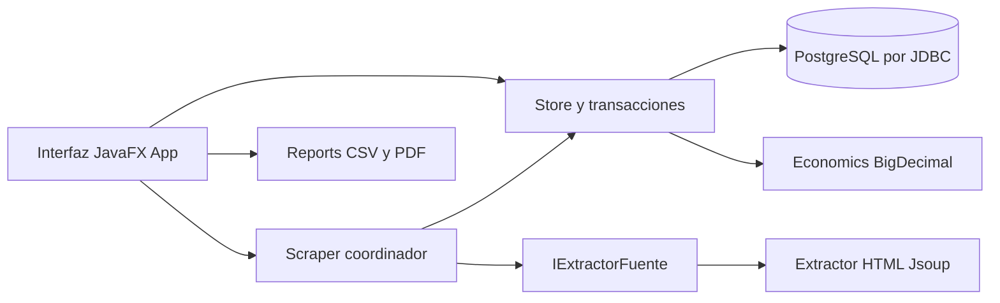

# Arquitectura del sistema

El sistema es una aplicación local de escritorio. No incluye servidor web ni integración con sistemas internos de Plaza Vea. La extracción utiliza exclusivamente el HTML obtenido por HTTP/HTTPS.

## Responsabilidades

`App` construye formularios y tablas, captura eventos y coordina tareas `JavaFX Task` en un único `ExecutorService`. El hilo JavaFX solo modifica controles. La barra inferior muestra la operación activa y el progreso indeterminado. Los controles se deshabilitan durante las operaciones para evitar envíos simultáneos.

`Store` es la frontera de persistencia y de las transacciones de aplicación. Agrupa consultas JDBC parametrizadas y operaciones que deben conservar atomicidad: revisión de homologación, comparación con snapshot, generación de alerta y atención. Comprueba sesión y permisos incluso cuando un método se invoca fuera de la interfaz. El sistema concentra los DAO en esta clase en lugar de crear un archivo DAO por entidad.

`Passwords` implementa PBKDF2-HMAC-SHA256 con 210000 iteraciones, sal aleatoria de 16 bytes y comparación de hashes de tiempo constante. `Config` lee el archivo editable `config/database.properties`. `Samples` carga catálogos de ejemplo de forma idempotente.

`IExtractorFuente` permite sustituir el extractor en pruebas o agregar otra implementación. `Extractor` selecciona la estrategia CSS, VTEX, JSON-LD o DEMO. `Scraper` registra inicio, resultado o error y utiliza `java.util.logging` con archivos rotativos.

`Economics` calcula con `BigDecimal`; `PriceParser` valida los importes PEN. `Reports` crea CSV escapado y PDF paginado. `ReportType` contiene consultas predefinidas; los filtros se parametrizan y nunca se interpolan como SQL.

## Flujo y permisos

Un administrador prepara productos, fuentes y vínculos y crea usuarios. Administrador y analista pueden extraer, revisar equivalencias, comparar, atender alertas y generar reportes. Los métodos administrativos rechazan sesiones de analista. El nombre del validador procede de la cuenta autenticada.

Cada vínculo representa un producto propio y una ficha de una fuente. Una extracción produce un resultado pendiente. La confirmación humana crea la homologación; el rechazo impide comparar. La comparación comprueba vigencia y estado activo y guarda una instantánea económica. Una comparación solo puede existir una vez por resultado.

## Despliegue

Una estación Windows ejecuta JDK 21 y JavaFX. PostgreSQL puede estar en la misma estación o en otro servidor, según el archivo de conexión. El arranque normal no crea ni inicia servidores. Las utilidades de clúster local son opcionales. Los reportes son archivos locales elegidos por el usuario.

La programación utiliza un `Timeline` que revisa cada 60 segundos los vínculos vencidos. La consulta de red se realiza en el trabajador de fondo. La próxima ejecución se guarda antes de consultar la página para evitar ciclos rápidos ante fallas. Cerrar sesión detiene la programación de esa aplicación; no existe un servicio del sistema operativo que continúe con la ventana cerrada.
